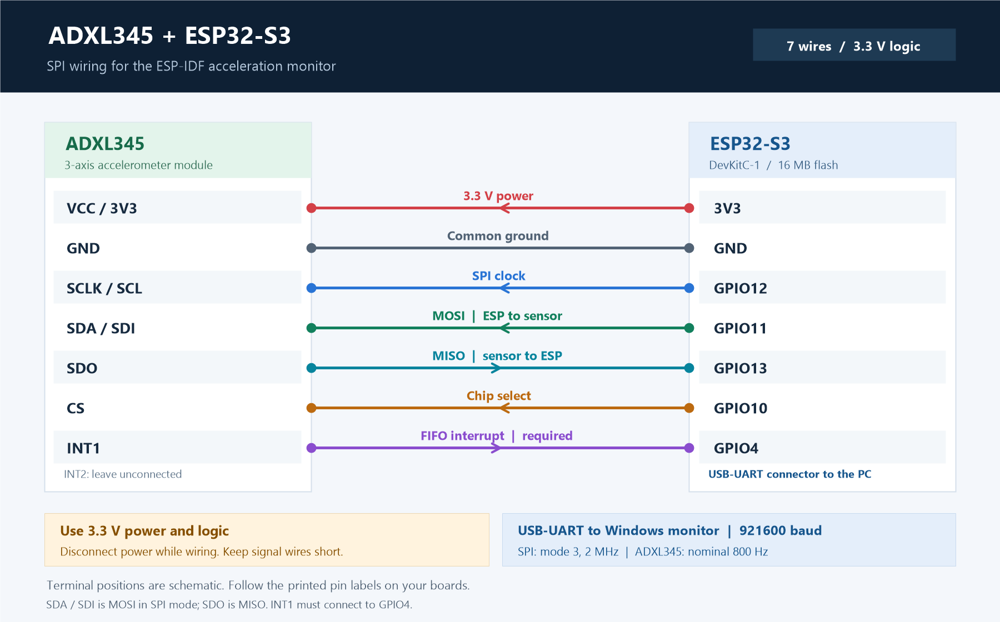
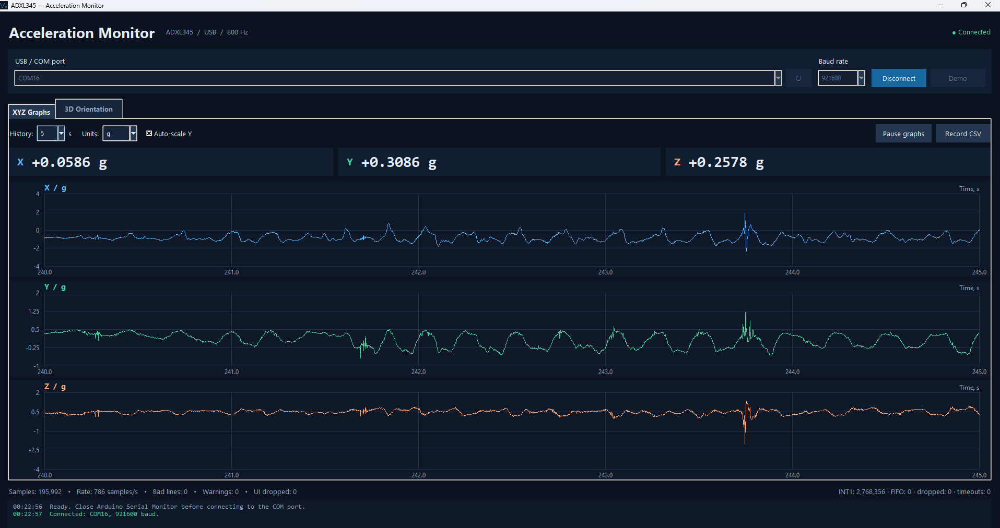
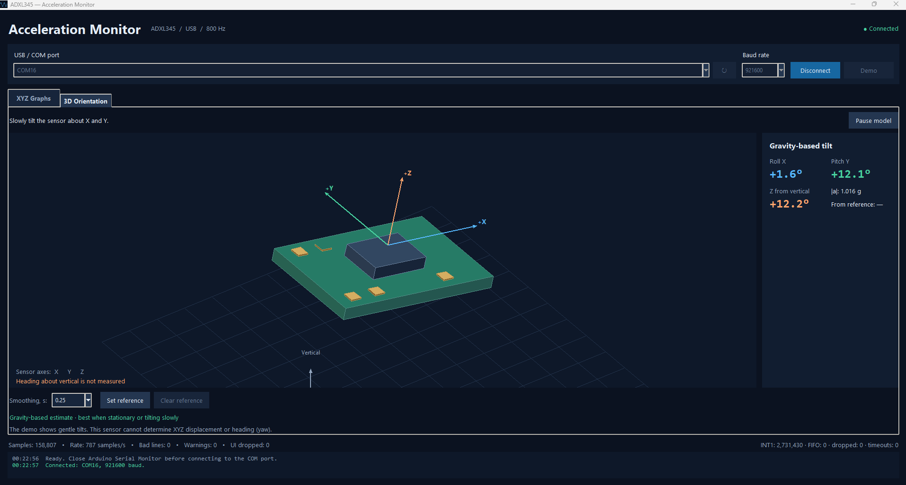

# ESP32-S3 ADXL345 Monitor

Native ESP-IDF C firmware for ADXL345 and an English desktop acceleration monitor.
Read XYZ over SPI, stream measurements through USB-UART, view live plots and a
gravity-based 3D tilt model, and record raw acceleration to CSV.

The repository contains source code, documentation, and setup/build scripts.
Firmware images, Windows executables, Python environments, toolchains, and
measurement files are generated locally and excluded from Git.

[Connect the sensor](#hardware) · [Install firmware](#1-install-the-ready-made-firmware) ·
[Start the monitor](#2-connect-and-view-acceleration) · [Record CSV](#3-record-and-save-csv) ·
[Build from source](#build-from-source)

## Download v1.0.0

Get the ready-to-flash **ESP-IDF firmware** and standalone **Windows x64 monitor**
from the [v1.0.0 release](https://github.com/nikitenkoandry/esp32s3-adxl345-monitor/releases/tag/v1.0.0).
You do not need ESP-IDF to install the packaged firmware, or Python to run the EXE.
The firmware upload helper requires Python 3.10+ and installs esptool separately.

| Download | What to use |
| --- | --- |
| [ESP-IDF firmware ZIP](https://github.com/nikitenkoandry/esp32s3-adxl345-monitor/releases/download/v1.0.0/esp32s3-adxl345-firmware-v1.0.0.zip) | Four firmware images and `Flash_Firmware.cmd` |
| [Windows x64 monitor ZIP](https://github.com/nikitenkoandry/esp32s3-adxl345-monitor/releases/download/v1.0.0/ADXL345-Monitor-Windows-x64-v1.0.0.zip) | `ADXL345_Monitor.exe`, demo launcher and guide |
| [SHA256SUMS.txt](https://github.com/nikitenkoandry/esp32s3-adxl345-monitor/releases/download/v1.0.0/SHA256SUMS.txt) | Checksums for the release downloads |

Extract both ZIPs into writable folders before running them. The GitHub **Source
code** archives contain the sources; download the assets above for ready-made
firmware and EXE files.

Start with the [wiring and launch guide](docs/quick-start.md). Release assets stay
on GitHub Releases; the repository keeps sources and documentation.

## Hardware

The supplied firmware configuration targets **ESP32-S3-DevKitC-1 with 16 MB flash**.
PSRAM is not required. Check the flash configuration before using another board.
Use an ADXL345 module with **3.3 V power and logic**, a shared ground, and a USB
data cable connected to the board's USB-UART port.
Disconnect power while connecting the seven wires.


Illustration based on Espressif's [official DevKitC-1 board reference](https://docs.espressif.com/projects/esp-dev-kits/en/latest/esp32s3/esp32-s3-devkitc-1/user_guide_v1.1.html).
The sensor terminal positions are illustrative; follow the pin labels on your
ADXL345 module. The table and schematic below show the same seven connections.

| ADXL345 | ESP32-S3 | Left header in the illustration |
| --- | --- | --- |
| VCC / 3V3 | 3V3 | J1 pin 1 |
| GND | GND | J1 pin 22 |
| SCLK / SCL | GPIO12 | J1 pin 18 |
| SDA / SDI / MOSI | GPIO11 | J1 pin 17 |
| SDO / MISO | GPIO13 | J1 pin 19 |
| CS | GPIO10 | J1 pin 16 |
| INT1 | GPIO4 | J1 pin 4 |

The illustrated board is viewed from the front, antenna up and USB sockets down.
**GPIO numbers and header pin positions are different:** GPIO4 is J1 pin 4,
but GPIO12 is J1 pin 18. Use the GPIO/power labels on your board. INT2 is unused.

<details>
<summary>Connection schematic and editable SVG</summary>



[Vector diagram (SVG)](docs/images/wiring-esp32s3-adxl345.svg).
Terminal positions are schematic; follow the printed pin labels on your boards.

</details>

**INT1 is required.** The firmware uses a one-sample FIFO watermark interrupt;
there is no polling fallback if the interrupt wire is missing.

## First use on Windows

### 1. Install the ready-made firmware

Connect the ESP32-S3 to the PC using the **USB-UART** connector shown in the
picture. The other connector, marked USB, is not the measurement-stream port
for this firmware. Find the assigned COM port in **Device Manager → Ports
(COM & LPT)**. `COM16` below is an example; replace it with your board's port.

Close other applications using that port. Install Python 3.10+ with pip/venv for
the flash helper; first use needs internet access to install esptool. Open
PowerShell in the extracted **firmware ZIP** folder:

```powershell
# Check the four images without accessing hardware:
.\Flash_Firmware.cmd --check

# Replace the installed firmware on the selected board:
.\Flash_Firmware.cmd COM16
```

Wait for a successful upload and board reset. Use all four images included in
the package for a first installation. If this firmware is already installed,
continue with the monitor steps. See the [Quick Start](docs/quick-start.md) if
automatic download mode fails or you need the BOOT/RESET procedure.

### 2. Connect and view acceleration

1. Open `ADXL345_Monitor.exe` from the extracted **Windows monitor ZIP**.
2. Select the board's COM port and **921600 baud**, then click **Connect**.
3. Check that **Samples** and **INT1** increase. Before recording, the footer
   shows IRQ/FIFO diagnostics; fault counters should remain zero in a healthy run.
4. Open **XYZ Graphs** for live X, Y and Z values. A stationary sensor normally
   has a total acceleration magnitude near **1 g** because gravity is included.
5. Open **3D Orientation** and tilt the sensor slowly about X and Y. Use
   **Smoothing** to adjust responsiveness or **Set reference** for comparison
   with a starting gravity direction.

The monitor EXE needs no Python installation. **460800 baud is the upload speed;
921600 baud is the monitor connection speed.** Only one application can use the
same COM port at a time.

### 3. Record and save CSV

1. Connect to the real board and confirm that new samples are arriving.
2. On **XYZ Graphs**, click **Record CSV**. Choose a writable folder and filename,
   for example `ADXL345_test_01.csv`, in the save dialog.
3. Confirm that **CSV: ... rows** grows in the footer. Recording starts when you
   select the file; earlier on-screen history is not exported.
4. Perform the measurement. You can switch to **3D Orientation** or pause either
   view while reception and recording continue.
5. Return to **XYZ Graphs**, click **Stop CSV**, and check the log message
   **CSV saved: ... samples.** The file is saved at the location you selected.

Disconnecting or closing the monitor also finishes the active recording. Use
**Stop CSV** to finish a measurement explicitly before opening its file in Excel
or processing it in Python. Import it as UTF-8 text with a comma delimiter and
`.` as the decimal separator.

The recorded file has this header:

```csv
sample,t_est_s,pc_rx_time_utc,x_g,y_g,z_g,gap_before
```

| Column | Meaning |
| --- | --- |
| `sample` | PC sample counter since connection; may start above zero in a new recording |
| `t_est_s` | Estimated time, `sample / 800`, in seconds |
| `pc_rx_time_utc` | PC reception/processing time in UTC; several samples can share it |
| `x_g`, `y_g`, `z_g` | Received acceleration in g, including gravity |
| `gap_before` | `1` marks a known discontinuity before this sample; `0` means none was reported |

Display units, graph scaling and 3D smoothing do not change recorded acceleration.
CSV writing happens before UI downsampling. The stream cannot recover samples
lost before reception or identify every unreported loss; a gap marker does not
give an exact missing-sample count. Neither CSV time column is an individual
sensor hardware timestamp. See the [monitor guide](tools/monitor/README.md#recording-and-time)
for details.

### 4. Try the interface without hardware

Run `Start_Demo.cmd` from the Windows monitor ZIP, or use the **Demo** button.
**DEMO** identifies synthetic data; CSV recorded in this mode is synthetic too.
Stop demo mode before connecting the real board.

## Monitor preview and controls

### Live XYZ acceleration



X is blue, Y green and Z orange. **History** changes the displayed time window,
**Units** selects g or m/s², and **Auto-scale Y** fits each graph independently.
**Pause graphs** freezes the view; **Record CSV / Stop CSV** controls file recording.

### Gravity-based 3D tilt



**Roll X / Pitch Y** estimate gravity-based tilt. **Set reference / Clear reference**
control comparison with a saved gravity direction. **Smoothing** reduces visual
jitter with more response delay. **Pause model** freezes only this view.
ADXL345 alone does not measure heading/yaw or reconstruct a stable movement path.

## If data do not appear

| Symptom | First checks |
| --- | --- |
| No COM port | USB data cable, USB-UART connector and USB-UART bridge driver |
| Port busy / access denied | Close other serial terminals or monitor instances |
| Connected but no XYZ | 921600 baud, 3.3 V, shared ground, SPI wires and INT1 → GPIO4 |
| CSV rows do not grow | Confirm reception, writable save folder, and check the log for a write error |
| Model jumps during motion | Move slowly, inspect XYZ and quality hints; linear acceleration can distort tilt |

See the [full troubleshooting guide](docs/quick-start.md#troubleshooting) for more.

## Build from source

For firmware, install **ESP-IDF 6.0.2** with ESP32-S3 tools and open its activated
terminal (or set `IDF_PATH` to its checkout). Arduino and PlatformIO are not
required. For the PC monitor, install **Python 3.10+ with Tkinter** and a working
`python` command; its setup script creates a separate local `.venv/`.

### Build and flash the ESP32-S3

Run these commands from the repository root in PowerShell:

```powershell
.\firmware\scripts\Install_Dependencies.cmd
.\firmware\scripts\Build_Firmware.cmd
.\firmware\scripts\Upload_Firmware.cmd COM16
```

Replace `COM16` with your board's port. Uploading replaces its installed firmware.
Close all serial monitors before uploading. `Install_Dependencies.cmd` checks and
activates an already installed ESP-IDF; it does not download a separate Arduino
framework. You can also open `firmware/` in the ESP-IDF VS Code extension.
The native CLI is `idf.py -DIDF_TARGET=esp32s3 build` from that folder.

### Run the monitor from source

```powershell
.\tools\monitor\scripts\Install_Dependencies.cmd
.\tools\monitor\scripts\Start_Monitor.cmd
```

Choose your COM port, select **921600 baud**, and click **Connect**. Open
**XYZ Graphs** for acceleration or **3D Orientation** for the tilt demonstration.
The COM port must be free of other serial applications.

### Run the source demo

```powershell
.\tools\monitor\scripts\Start_3D_Demo.cmd
```

**DEMO** clearly identifies synthetic data. Firmware setup is unnecessary for
this mode; only the monitor environment is required.

## Project layout

```text
firmware/                  Native ESP-IDF 6.0.2 C project
  main/                    SPI driver, ISR/task, UART, and compatible protocol
  tests/host/              Native C driver/task/protocol regression checks
  scripts/                 Windows ESP-IDF environment/build/upload helpers
tools/monitor/             Standalone Python/Tk desktop tool
  pc_monitor/              Interface, serial receiver, and tilt visualization
  scripts/                 Windows setup, launch, test, and EXE build helpers
  tests/                   Parser, recording, tilt, and diagnostics tests
  verify_board.py          Optional real-board stream verification
docs/                      Wiring illustrations, protocol and validation notes
```

## What is included

| Component | Behavior |
| --- | --- |
| SPI acquisition | Mode 3, 2 MHz, full resolution, +/-16 g, nominal 800 Hz ODR |
| Interrupt handling | INT1 wakes a FreeRTOS task; SPI and UART stay outside the ISR |
| Buffering | Sensor stream FIFO plus a nonblocking 512-sample RAM queue |
| XYZ plots | Live values, 2–60 s history, g or m/s², independent scaling, graph pause |
| 3D tilt | Roll/pitch, reference pose, smoothing, independent model pause, quality hints |
| Recording | Raw acceleration in g, CSV sample counters, PC times, and gap markers |
| Diagnostics | INT1 edges, FIFO full events, firmware queue drops, and timeouts |

Graph/model pauses and tab switching do not stop reception or active recording.

## Timing and measurement scope

**800 Hz is the nominal setting**, not a promise of an exact measured rate. The
previously tested sensor produced about 785.7 samples/s. Graph time is estimated
from received sample count / 800; XYZ lines have no individual hardware timestamp.

Acceleration includes gravity. The model estimates two gravity-based tilt angles
when stationary or moving gently. It does not determine heading/yaw, a stable XYZ
travel path, or full six-degree-of-freedom motion. Strong linear acceleration can
distort the estimate. See the detailed monitor guide for interpretation.

## Tests and optional Windows EXE

Native C host checks (requires GCC/Clang and the monitor Python environment):

```powershell
.\tools\monitor\.venv\Scripts\python.exe firmware\tests\host\run_tests.py
```

Monitor checks and optional packaging:

```powershell
.\tools\monitor\scripts\Run_Tests.cmd
.\tools\monitor\scripts\Build_EXE.cmd
```

The EXE is generated at `tools/monitor/dist/ADXL345_Monitor.exe`; it needs no
Python installation on the destination PC. It is not committed to this source
repository. The launch scripts prefer a locally built EXE when present.

For automation, setup/build/test scripts accept `/nopause` as their first
argument; the upload script accepts it after the COM port.

## Documentation

- [Firmware setup and architecture](firmware/README.md)
- [Release quick start: wiring, flashing, and Windows EXE](docs/quick-start.md)
- [Monitor controls, recording, and troubleshooting](tools/monitor/README.md)
- [Serial protocol and diagnostic fields](docs/serial-protocol.md)
- [Historical hardware verification and reproducible checks](docs/validation.md)

The C source files include English descriptions of the wiring, data flow,
configuration, error handling, and timing limitations. The existing Python
monitor remains unchanged; the previous Arduino firmware is in Git history.

## Preparing release assets

After building the Windows EXE, run from the repository root:

```powershell
.\tools\monitor\.venv\Scripts\python.exe scripts\release\build_release.py
```

This verifies the four firmware image hashes against the hardware-tested v1.0.0
images and checks that their sources still match the verified revision. It
creates ZIPs, a Quick Start, and SHA-256 checksums under `dist/v1.0.0/`, without
opening a COM port or publishing. See [release notes](docs/releases/v1.0.0.md).
