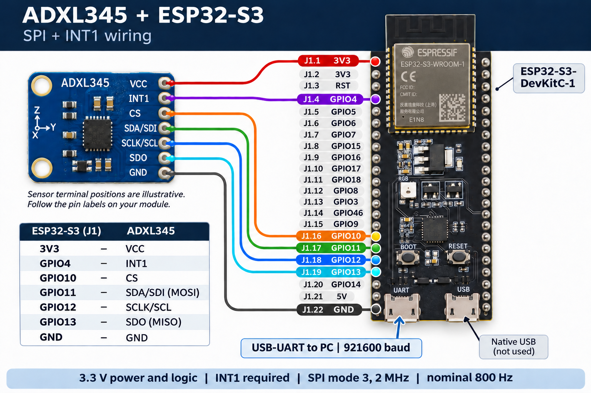

# ESP32-S3 ADXL345 Monitor

Native ESP-IDF C firmware for ADXL345 and an English desktop acceleration monitor.
Read XYZ over SPI, stream measurements through USB-UART, view live plots and a
gravity-based 3D tilt model, and record raw acceleration to CSV.

The repository contains source code, documentation, and setup/build scripts.
Firmware images, Windows executables, Python environments, toolchains, and
measurement files are generated locally and excluded from Git.

## Download v1.0.0

Get the ready-to-flash **ESP-IDF firmware** and standalone **Windows x64 monitor**
from the [v1.0.0 release](https://github.com/nikitenkoandry/esp32s3-adxl345-monitor/releases/tag/v1.0.0).
You do not need ESP-IDF to install the packaged firmware, or Python to run the EXE.
The firmware upload helper requires Python 3.10+ and installs esptool separately.

Start with the [wiring and launch guide](docs/quick-start.md). Release assets stay
on GitHub Releases; the repository keeps sources and documentation.

## Monitor preview

### Live XYZ acceleration


Three synchronized plots, current acceleration, CSV recording, and stream health.

### Gravity-based 3D tilt


Roll/pitch, adjustable smoothing, and a reference pose. These screenshots show a
real connected monitor; ADXL345 alone does not measure yaw or a movement path.

## Project layout

```text
firmware/                  Native ESP-IDF 6.0.2 C project
  main/                    SPI driver, ISR/task, UART, and compatible protocol
  tests/host/              Native C driver/task/protocol regression checks
  scripts/                 Windows ESP-IDF environment/build/upload helpers
tools/monitor/             Standalone Python/Tk desktop tool
  pc_monitor/              Interface, serial receiver, and tilt visualization
  scripts/                 Windows setup, launch, test, and EXE build helpers
  tests/                   Parser, recording, tilt, and diagnostics tests
  verify_board.py          Optional real-board stream verification
docs/                      Serial protocol and historical validation notes
```

## Hardware

The supplied firmware configuration targets **ESP32-S3-DevKitC-1 with 16 MB flash**.
PSRAM is not required. Check the flash configuration before using another board.
Use an ADXL345 module with **3.3 V power and logic**, a shared ground, and a USB
data cable connected to the board's USB-UART port.



Illustration based on Espressif's [official DevKitC-1 board reference](https://docs.espressif.com/projects/esp-dev-kits/en/latest/esp32s3/esp32-s3-devkitc-1/user_guide_v1.1.html).
The sensor terminal positions are illustrative; follow the pin labels on your
ADXL345 module. The table and schematic below show the same seven connections.

| ADXL345 | ESP32-S3 |
| --- | --- |
| VCC | 3V3 |
| GND | GND |
| SCLK | GPIO12 |
| SDA / SDI / MOSI | GPIO11 |
| SDO / MISO | GPIO13 |
| CS | GPIO10 |
| INT1 | GPIO4 |


[Vector diagram (SVG)](docs/images/wiring-esp32s3-adxl345.svg).
Terminal positions are schematic; follow the printed pin labels on your boards.

**INT1 is required.** The firmware uses a one-sample FIFO watermark interrupt;
there is no polling fallback if the interrupt wire is missing.

## Quick start on Windows

For firmware, install **ESP-IDF 6.0.2** with ESP32-S3 tools and open its activated
terminal (or set `IDF_PATH` to its checkout). Arduino and PlatformIO are not
required. For the PC monitor, install **Python 3.10+ with Tkinter** and a working
`python` command; its setup script creates a separate local `.venv/`.

### 1. Build and flash the ESP32-S3

Run these commands from the repository root in PowerShell:

```powershell
.\firmware\scripts\Install_Dependencies.cmd
.\firmware\scripts\Build_Firmware.cmd
.\firmware\scripts\Upload_Firmware.cmd COM16
```

Replace `COM16` with your board's port. Uploading replaces its installed firmware.
Close all serial monitors before uploading. `Install_Dependencies.cmd` checks and
activates an already installed ESP-IDF; it does not download a separate Arduino
framework. You can also open `firmware/` in the ESP-IDF VS Code extension.
The native CLI is `idf.py -DIDF_TARGET=esp32s3 build` from that folder.

### 2. Start the desktop monitor

```powershell
.\tools\monitor\scripts\Install_Dependencies.cmd
.\tools\monitor\scripts\Start_Monitor.cmd
```

Choose your COM port, select **921600 baud**, and click **Connect**. Open
**XYZ Graphs** for acceleration or **3D Orientation** for the tilt demonstration.
The COM port must be free of other serial applications.

### 3. Try it without hardware

```powershell
.\tools\monitor\scripts\Start_3D_Demo.cmd
```

**DEMO** clearly identifies synthetic data. Firmware setup is unnecessary for
this mode; only the monitor environment is required.

## What is included

| Component | Behavior |
| --- | --- |
| SPI acquisition | Mode 3, 2 MHz, full resolution, +/-16 g, nominal 800 Hz ODR |
| Interrupt handling | INT1 wakes a FreeRTOS task; SPI and UART stay outside the ISR |
| Buffering | Sensor stream FIFO plus a nonblocking 512-sample RAM queue |
| XYZ plots | Live values, 2–60 s history, g or m/s², independent scaling, graph pause |
| 3D tilt | Roll/pitch, reference pose, smoothing, independent model pause, quality hints |
| Recording | Raw acceleration in g, CSV sample counters, PC times, and gap markers |
| Diagnostics | INT1 edges, FIFO full events, firmware queue drops, and timeouts |

Graph/model pauses and tab switching do not stop reception or active recording.

## Timing and measurement scope

**800 Hz is the nominal setting**, not a promise of an exact measured rate. The
previously tested sensor produced about 785.7 samples/s. Graph time is estimated
from received sample count / 800; XYZ lines have no individual hardware timestamp.

Acceleration includes gravity. The model estimates two gravity-based tilt angles
when stationary or moving gently. It does not determine heading/yaw, a stable XYZ
travel path, or full six-degree-of-freedom motion. Strong linear acceleration can
distort the estimate. See the detailed monitor guide for interpretation.

## Tests and optional Windows EXE

Native C host checks (requires GCC/Clang and the monitor Python environment):

```powershell
.\tools\monitor\.venv\Scripts\python.exe firmware\tests\host\run_tests.py
```

Monitor checks and optional packaging:

```powershell
.\tools\monitor\scripts\Run_Tests.cmd
.\tools\monitor\scripts\Build_EXE.cmd
```

The EXE is generated at `tools/monitor/dist/ADXL345_Monitor.exe`; it needs no
Python installation on the destination PC. It is not committed to this source
repository. The launch scripts prefer a locally built EXE when present.

For automation, setup/build/test scripts accept `/nopause` as their first
argument; the upload script accepts it after the COM port.

## Documentation

- [Firmware setup and architecture](firmware/README.md)
- [Release quick start: wiring, flashing, and Windows EXE](docs/quick-start.md)
- [Monitor controls, recording, and troubleshooting](tools/monitor/README.md)
- [Serial protocol and diagnostic fields](docs/serial-protocol.md)
- [Historical hardware verification and reproducible checks](docs/validation.md)

The C source files include English descriptions of the wiring, data flow,
configuration, error handling, and timing limitations. The existing Python
monitor remains unchanged; the previous Arduino firmware is in Git history.

## Preparing release assets

After building the Windows EXE, run from the repository root:

```powershell
.\tools\monitor\.venv\Scripts\python.exe scripts\release\build_release.py
```

This verifies the four firmware image hashes against the hardware-tested v1.0.0
images and checks that their sources still match the verified revision. It
creates ZIPs, a Quick Start, and SHA-256 checksums under `dist/v1.0.0/`, without
opening a COM port or publishing. See [release notes](docs/releases/v1.0.0.md).
