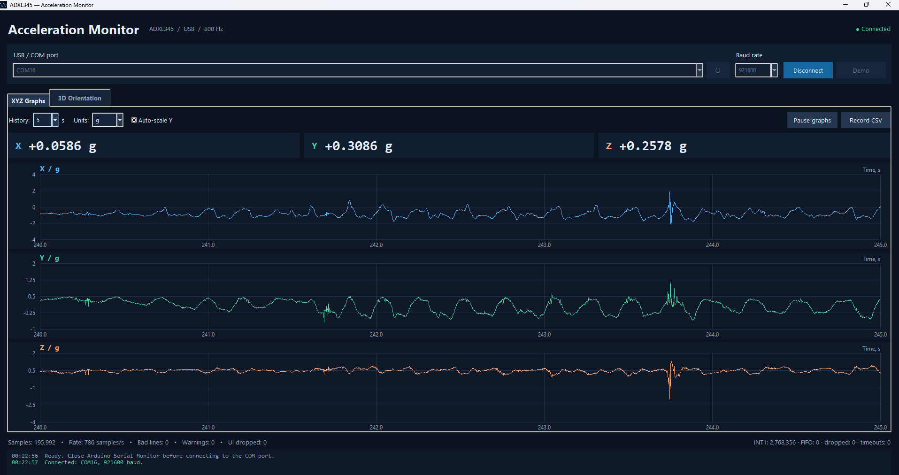
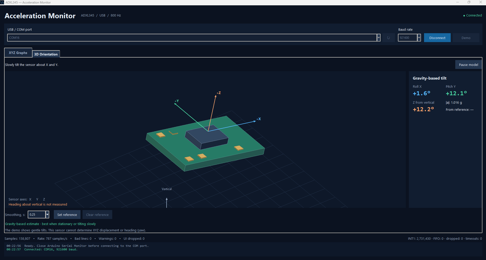

# ESP32-S3 ADXL345 Monitor v1.0.0 — Quick Start

## 1. Download

Open the [v1.0.0 release](https://github.com/nikitenkoandry/esp32s3-adxl345-monitor/releases/tag/v1.0.0)
and download:

| File | Purpose |
| --- | --- |
| `esp32s3-adxl345-firmware-v1.0.0.zip` | Four ESP-IDF images and Windows flash helper |
| `ADXL345-Monitor-Windows-x64-v1.0.0.zip` | Standalone EXE, demo launcher and screenshots |
| `SHA256SUMS.txt` | SHA-256 checksums of both ZIPs and this guide |

Extract the ZIPs before running anything. The monitor targets Windows 10/11 x64
and requires no Python or ESP-IDF. Uploading firmware requires **Python 3.10+**
with pip/venv and internet access for the first esptool installation.

This release reuses the exact firmware image bytes tested on 19 November 2026.
The manifest records their hashes and corresponding source revision. The
embedded project-version label remains that of the original pre-commit build;
the source release tag is `v1.0.0`.

## 2. Connect the hardware

Use **ESP32-S3-DevKitC-1 with 16 MB flash**, an ADXL345 module with **3.3 V power
and logic**, and a USB data cable. Disconnect power while wiring.

| ADXL345 pin | ESP32-S3 pin | Function |
| --- | --- | --- |
| VCC / 3V3 | 3V3 | 3.3 V supply |
| GND | GND | Shared ground |
| SCLK / SCL | GPIO12 | SPI clock |
| SDA / SDI / MOSI | GPIO11 | Data to sensor |
| SDO / MISO | GPIO13 | Data from sensor |
| CS | GPIO10 | SPI chip select |
| INT1 | GPIO4 | FIFO watermark interrupt; required |

SPI uses mode 3 at 2 MHz. INT2 is unused. Keep signal wires short.
Use the board's **USB-to-UART connector**, connected to UART0 on GPIO43/44.
Native USB/USB Serial-JTAG is not used for the measurement stream. Install the
USB-UART bridge driver for your board if needed.

Find the assigned port in Windows Device Manager → Ports (COM & LPT).
`COM16` below is an example; use your actual port.

## 3. Install the firmware

Close the monitor and other serial applications. Open PowerShell in the extracted
firmware folder. Uploading replaces the selected board's installed firmware:

```powershell
# Validate the images without opening hardware or installing esptool:
.\Flash_Firmware.cmd --check

# Replace COM16 with the board's actual USB-UART port:
.\Flash_Firmware.cmd COM16
```

The helper creates `.flash-venv` and installs **esptool 5.3.1** on first use. It
verifies all four packaged SHA-256 hashes before flashing at 460800 baud, with
chip ESP32-S3, DIO, 80 MHz and 16 MB flash settings:

| Address | Image |
| --- | --- |
| `0x00000` | `bootloader/bootloader.bin` |
| `0x08000` | `partition_table/partition-table.bin` |
| `0x0E000` | `ota_data_initial.bin` |
| `0x10000` | `adxl345_monitor.bin` |

Wait for successful completion and board reset. The helper does not perform a
full-chip erase. For first installation, upload all four supplied images rather
than the application image alone.

If automatic download mode fails, hold **BOOT**, briefly press **RESET/EN**,
release **BOOT**, and retry. Press RESET/EN after a manual download if needed.
ESP-IDF users can instead run `python -m esptool` with the same offsets/settings.

## 4. Start the monitor

1. Run `ADXL345_Monitor.exe` from the extracted Windows monitor folder.
2. Select the board's COM port and **921600 baud**.
3. Click **Connect**. Samples and INT1 counters should increase.
4. Open **XYZ Graphs** for acceleration traces.
5. Open **3D Orientation** and slowly tilt the sensor about X and Y.





Use **History**, **Units**, and **Auto-scale Y** to adjust plots. **Record CSV**
saves received raw acceleration in g. Graph/model pause freezes only that view;
reception and active recording continue. **Set reference** stores a gravity
direction. **Smoothing** trades faster response for less visual jitter.

Without hardware, run `Start_Demo.cmd` from the monitor ZIP or click **Demo**.
Synthetic data are explicitly marked **DEMO**. The packaged EXE is unsigned.

## 5. Check the stream

The footer shows **Samples**, recent **Rate**, **Bad lines**, **Warnings**,
**UI dropped**, **INT1**, **FIFO**, firmware **dropped**, and **timeouts**.
Samples/INT1 should increase and fault counters should remain zero during a
healthy steady-state run. USB batches can make the short-term rate vary.

The configuration is **nominal 800 Hz**, full-resolution +/-16 g. The tested
sensor actually produced about **785.5 samples/s**. A stationary sensor's total
acceleration is normally near 1 g because the stream includes gravity. Plot time
is estimated from sample count / 800, not individual hardware timestamps.

The 3D view estimates **gravity-based tilt**. It cannot measure heading/yaw,
reconstruct an XYZ travel path, or provide full motion tracking. Fast movement
and linear acceleration can distort the estimate; tilt slowly for the demo.

## Troubleshooting

| Symptom | Check |
| --- | --- |
| No COM port | Data cable, USB-UART connector, bridge driver, Device Manager |
| Port busy / access denied | Disconnect other monitors and close serial terminals |
| Flash connection fails | Correct port, power, BOOT/RESET procedure |
| Connected but no XYZ | INT1 → GPIO4, 3.3 V, ground, SPI wiring, then reset |
| Garbled text / bad lines | 921600 baud for monitoring; 460800 is only for upload |
| FIFO/drop/timeout faults | Check wiring, power, PC load and port ownership; restart after fixing |
| Model jitters during movement | Move slowly or increase smoothing; inspect raw XYZ |

## Verify downloads

Compare PowerShell output with `SHA256SUMS.txt` in the download folder:

```powershell
Get-FileHash .\esp32s3-adxl345-firmware-v1.0.0.zip -Algorithm SHA256
Get-FileHash .\ADXL345-Monitor-Windows-x64-v1.0.0.zip -Algorithm SHA256
```

See the [monitor guide](https://github.com/nikitenkoandry/esp32s3-adxl345-monitor/blob/v1.0.0/tools/monitor/README.md)
for controls and CSV interpretation and [validation notes](https://github.com/nikitenkoandry/esp32s3-adxl345-monitor/blob/v1.0.0/docs/validation.md)
for hardware test results and their scope.
