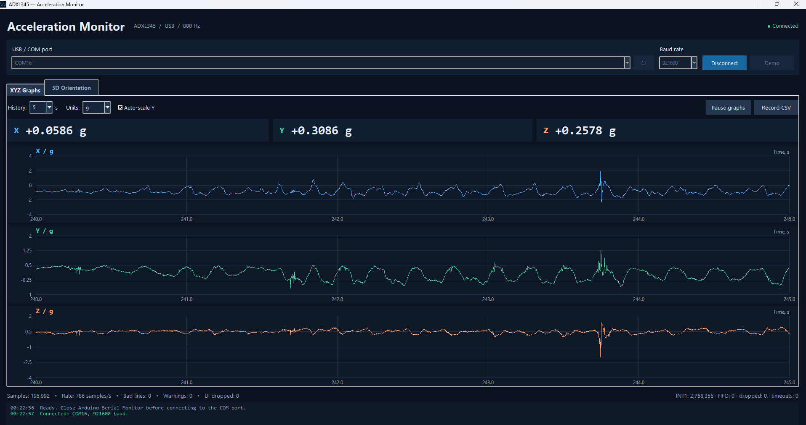
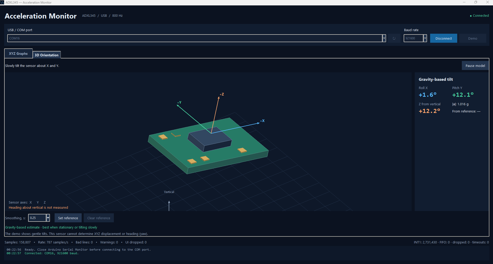

# v1.0.0 — ESP-IDF firmware and Windows monitor

First packaged release: native C firmware using ESP-IDF 6.0.2, interrupt-driven
ADXL345 SPI acquisition, and a standalone Windows x64 monitor.

## Download and start

| Asset | Contents |
| --- | --- |
| `esp32s3-adxl345-firmware-v1.0.0.zip` | Hardware-verified bootloader, partitions, OTA initialization and app; checksum-checked flash helper |
| `ADXL345-Monitor-Windows-x64-v1.0.0.zip` | EXE, demo launcher, guide and screenshots |
| `QUICK_START.md` | Wiring, upload, launch, controls and troubleshooting |
| `SHA256SUMS.txt` | Checksums of both ZIPs and the standalone guide |

Read the [Quick Start](https://github.com/nikitenkoandry/esp32s3-adxl345-monitor/blob/v1.0.0/docs/quick-start.md).
Extract the archives, wire the sensor, run `Flash_Firmware.cmd COM16` with your
actual port, then open `ADXL345_Monitor.exe`, select **921600 baud**, and connect.
The EXE needs no Python installation. Flashing requires Python 3.10+ and first-use
internet access for esptool 5.3.1; ESP-IDF is not required.

**Target:** ESP32-S3-DevKitC-1, 16 MB flash; ADXL345 at 3.3 V.
SCLK=12, MOSI=11, MISO=13, CS=10, **INT1=4**. Use the USB-UART connector.

## Features

- SPI mode 3 at 2 MHz; nominal 800 Hz, full-resolution +/-16 g acquisition.
- INT1/FIFO-driven reads, FreeRTOS buffering and stream-health counters.
- Live XYZ acceleration, g/m/s², CSV recording and adjustable history.
- Gravity-based 3D tilt, smoothing and reference-pose comparison.
- Hardware-free demo and a compatible USB-UART CSV protocol.

## UI preview

### XYZ acceleration

### 3D tilt

## Validation and limits

The released firmware images are byte-for-byte identical to those flashed and
tested on 19 November 2026: **94,256 samples over 120 seconds**, approximately
**785.46 samples/s**, with zero reported FIFO full events, queue drops, timeouts,
SPI faults, malformed lines or warnings. Live graphs and the 3D model were
observed in the unchanged Windows monitor. The image manifest retains the
original pre-commit build label, matching source revision and hashes.

All **24 monitor tests pass**. The EXE was packaged with PyInstaller 6.22.3 for
Windows x64 and is unsigned. Release archives include SHA-256 manifests.

800 Hz is nominal. Acceleration includes gravity; the 3D model estimates tilt
and cannot measure yaw or reconstruct a stable movement path. Physical angle
accuracy was not calibrated. See the [full validation notes](https://github.com/nikitenkoandry/esp32s3-adxl345-monitor/blob/v1.0.0/docs/validation.md).
